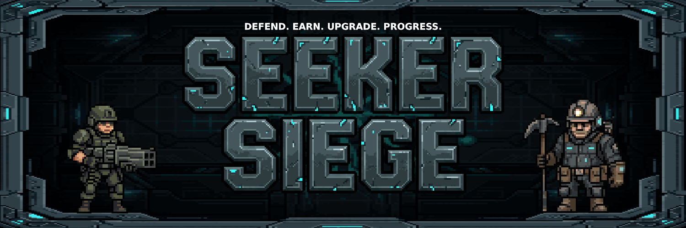
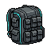
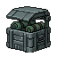
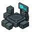

  

<h3 align="center"><a href="https://drive.google.com/drive/folders/1Q2P3jlS91to5cpH9X4Bw5yfvXtfTInMB?usp=sharing">📲 Download the APK</a></h3>

> **Note:**
> - Seeker Siege runs on a live VPS right now, this isn't a local-only demo.
> - The game doesn't have an in-game tutorial yet. In the meantime, you can use the steps below as a reference.
> - Switch your Seed Vault wallet's network to **Devnet** in its settings before doing any on-chain transactions in-game.

## How to test

Download the APK → Install it on your Seeker or Solana Mobile device → Connect your wallet to log in

**Game Menu** 

**Inventory:**  | **Shop:**  | **Marketplace:**  | **Profile:**  | **Settings:** 

**1. Assign your resource drop rates**

A one-time popup will appear on your first login.

**2. Claim your towers**

Claiming towers requires holding at least 0.01 SOL, up to 0.1 SOL.

Get devnet SOL here: [faucet.solana.com](https://faucet.solana.com/)

Tap Shop → Claim any towers

**3. Place your towers**

Tap **"Show Placement: ON"** at the upper left to see valid placement tiles (they glow green) → Tap a tile → Tap **"Build"** → Select a tower → Tap **"Confirm"**

**4. Start the wave**

Tap **"Start"** at the top center of the screen

**5. CLOCK IN testing**

Tap  → Go to CLOCK IN mini tab → Request resources and dummy SKR

**6. Test the rest of the shipped features listed below**

---

## ✅ Shipped Features

- Wallet connect via Seed Vault / Mobile Wallet Adapter
- Wallet gated tower claiming: 0.01 SOL per tower, 10 unit cap
- Tower Keep: choose which towers stay enabled if holdings drop
- P2P Marketplace with on-chain SKR/SOL settlement, 5% fee, buy/sell/cancel (devnet)
- Vault Withdrawal: move in-game SKR balance to your real wallet via a deployed onchain program (devnet)
- SKR Exchange: resources to SKR, daily cap gated by SOL holdings, shared daily pool
- Resources Exchange: resource to resource swap, shared daily pool
- Real-time tower defense combat across multiple maps (Region 1, Maps 1 - 15)
- Tower levels, tiers, ascension, and a full Skill Tree
- Server-authoritative economy: resource/SKR drops, progression, EXP, tower claims, marketplace trades, and skill purchases are all validated server-side. The client handles combat and rendering, but the server is the source of truth for every reward and balance.

---

## ⌛ In development

- Mining Shaft: holdings gated miner units
- Deployment units: holdings gated infantry and mobile soldiers, unlocked post-Act 1
- Act 2: Equipment Forging, Regions 2–5, Guilds/Colonies, player-vs-player base raids, guild-vs-guild raids, Boss Rush with leaderboard
- Mainnet migration

---

## Known constraints / things worth knowing

- **Mobile Wallet Adapter only:** the Solana SDK supports other well-known Solana wallets, but this dApp is configured and tested for MWA only.
- **Devnet only, for now:** `HOLDING_SOURCE` and `SOLANA_RPC_URL` on the backend currently point at Solana devnet.
- **Game Audio:** Audio has been deprioritized and is not available in the current version.